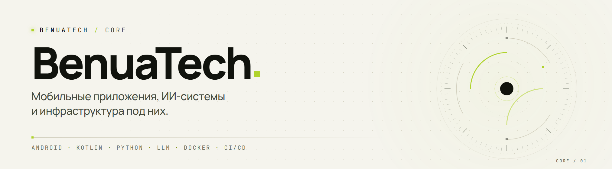
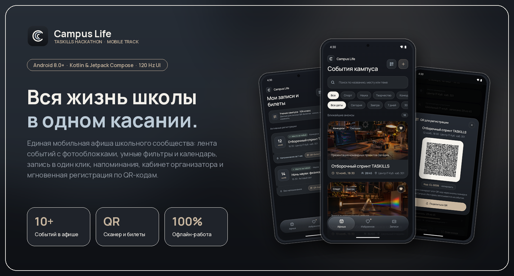
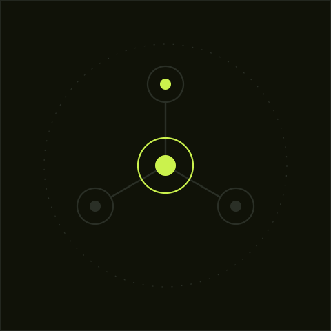
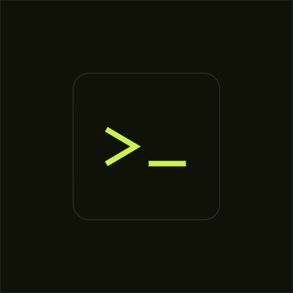

<picture>
  <source media="(prefers-color-scheme: dark)" srcset="assets/banner-dark.png">
  <source media="(prefers-color-scheme: light)" srcset="assets/banner-light.png">
  
</picture>

 

**Инженерная команда. Продукт целиком — от дизайн-системы до релиза.**

BenuaTech-Core собирает мобильные приложения, ИИ-системы и инфраструктуру, которая их держит.
Не прототипы для галочки: релизы, тесты, документация.

---

## Продукты

### 01 · Campus Life

**Мобильная афиша школьного сообщества.** Нативное Android-приложение: лента событий с поиском и фильтрами, запись в один клик, персональные QR-билеты, системные напоминания и кабинет организатора со сканером входа. Собственная дизайн-система, релизный APK и записанное демо.

  

`Kotlin` `Jetpack Compose` `CameraX` `ZXing` — **TASKILLS, трек «Мобильная разработка»** — [Репозиторий →](https://github.com/Thebenua/portfolio-site)

 

<table>
  <tr>
    <td width="96" valign="top">
      
    </td>
    <td valign="top">
      <h3>02 · AI Agent Orchestrator</h3>
      
Асинхронный каркас для автономных ИИ-агентов: изолированный слой системных промптов, любой OpenAI-совместимый провайдер, повторные попытки при сбоях сети, конфигурация через окружение и офлайн-тесты в CI.

      
<code>Python</code> <code>asyncio</code> <code>OpenAI SDK</code> <code>Docker</code> — <a href="https://github.com/Thebenua/ai-agent-orchestrator">Репозиторий →</a>

    </td>
  </tr>
  <tr>
    <td width="96" valign="top">
      
    </td>
    <td valign="top">
      <h3>03 · Telegram Bot Template</h3>
      
Боевой шаблон бота на aiogram 3: PostgreSQL, SQLAlchemy, Redis, антифлуд, обработка ошибок, Docker от непривилегированного пользователя и CI с тестами. То, с чего начинается каждый новый бот.

      
<code>Python</code> <code>aiogram 3</code> <code>PostgreSQL</code> <code>Redis</code> — <a href="https://github.com/Thebenua/aiogram3-bot-template">Репозиторий →</a>

    </td>
  </tr>
</table>

---

## Направления

<table>
  <tr>
    <td width="33%" valign="top">
      <h4>Мобильные продукты</h4>
      
Нативные приложения на Kotlin и Compose: собственные дизайн-системы, продуманные состояния экранов, 90 и 120 Гц, работа без сети.

    </td>
    <td width="33%" valign="top">
      <h4>ИИ-системы</h4>
      
Автономные агенты и ИИ-ядро для приложений: промпты как код, устойчивость к сбоям, предсказуемая стоимость вызова модели.

    </td>
    <td width="33%" valign="top">
      <h4>Инфраструктура</h4>
      
Docker, CI с тестами и линтерами, конфигурация через окружение. Всё, что превращает прототип в то, что можно поддерживать.

    </td>
  </tr>
</table>

---

## Как мы работаем

- **Продукт, а не демо.** Не бросаем на уровне «работает у меня на телефоне»: релиз, демо, документация.
- **Дизайн-система с первого экрана.** Цвет, сетка, типографика и состояния продумываются до вёрстки, а не после.
- **Тесты и CI по умолчанию.** Сборка, линтер, автотесты — в каждом репозитории, а не «когда-нибудь».
- **Документация — часть продукта.** README объясняет, как запустить, а не только что это такое.

---

## Ближайшие цели

- Довести Campus Life до пилота в школе: рабочий релиз, QR-регистрация на реальных событиях.
- Открыть AI Agent Orchestrator как самостоятельный инструмент, а не внутренний каркас.
- Собрать в организации все проекты команды — с описаниями, темами и релизами.

 
BENUATECH-CORE · 2026

